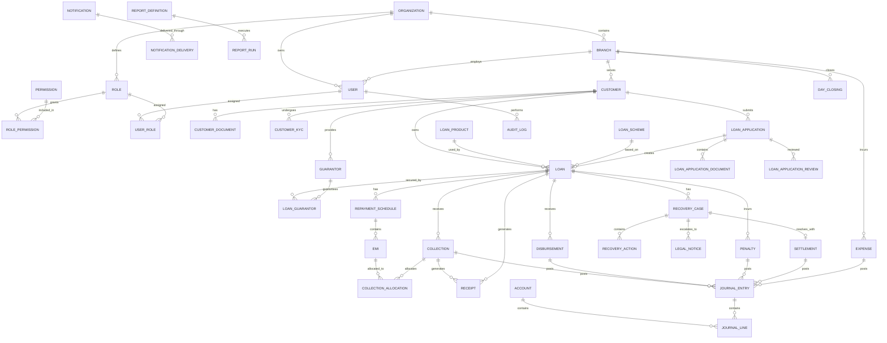

# PostgreSQL Database Schema — Loan Management System (LMS)

> Production-oriented PostgreSQL schema for the Loan Management System (NBFC / microfinance).
>
> Core rules:
>
> - All money is `BIGINT` in paise.
> - EMI due dates are `DATE`.
> - Every table contains `org_id`.
> - PostgreSQL Row-Level Security (RLS) is mandatory.
> - Audit tables are append-only.
> - The accounting ledger is double-entry and append-only.
> - Balances are derived from ledger postings and are never stored as mutable columns.

---

# 1. Database Design Principles

| Rule                | Implementation                           |
| ------------------- | ---------------------------------------- |
| Multi-tenancy       | `org_id UUID NOT NULL` on every table    |
| Tenant isolation    | PostgreSQL RLS on every table            |
| Money               | `BIGINT` paise                           |
| EMI due date        | `DATE`                                   |
| Audit history       | Append-only                              |
| Ledger              | Double-entry, append-only                |
| Balances            | Derived from journal lines               |
| Corrections         | Reversal/new transaction, never mutation |
| Payment idempotency | `(org_id, idempotency_key)` unique       |

Forbidden mutable financial columns include:

```text
loan.outstanding_amount
loan.principal_balance
loan.interest_balance
loan.penalty_balance
loan.total_paid
customer.total_outstanding
branch.cash_balance
user.cash_balance
```

---

# 2. Mermaid ER Diagram



---

# 3. Tenant / Organization

## `organizations`

| Column          | Type                  | Constraints            |
| --------------- | --------------------- | ---------------------- |
| `org_id`        | UUID                  | PK                     |
| `name`          | VARCHAR(200)          | NOT NULL               |
| `code`          | VARCHAR(50)           | NOT NULL, UNIQUE       |
| `legal_name`    | VARCHAR(250)          | NULL                   |
| `logo_file_ref` | TEXT                  | NULL                   |
| `status`        | `organization_status` | NOT NULL               |
| `timezone`      | VARCHAR(64)           | DEFAULT `Asia/Kolkata` |
| `created_at`    | TIMESTAMPTZ           | NOT NULL               |
| `updated_at`    | TIMESTAMPTZ           | NOT NULL               |

## `branches`

```text
org_id UUID NOT NULL
branch_id UUID NOT NULL
code VARCHAR(50) NOT NULL
name VARCHAR(200) NOT NULL
address_line1 VARCHAR(250) NOT NULL
address_line2 VARCHAR(250)
city VARCHAR(100) NOT NULL
state VARCHAR(100) NOT NULL
pincode VARCHAR(10) NOT NULL
phone VARCHAR(30)
status branch_status NOT NULL
created_at TIMESTAMPTZ NOT NULL
updated_at TIMESTAMPTZ NOT NULL

PRIMARY KEY (org_id, branch_id)
UNIQUE (org_id, code)
FK (org_id, branch_id) -> branches
```

All tenant-scoped foreign keys should use composite `(org_id, entity_id)` references.

---

# 4. Authentication / RBAC

## `users`

```text
org_id UUID NOT NULL
user_id UUID NOT NULL
branch_id UUID
employee_code VARCHAR(50)
name VARCHAR(200) NOT NULL
email VARCHAR(320)
mobile VARCHAR(20)
password_hash TEXT
status user_status NOT NULL
failed_login_attempts INTEGER NOT NULL DEFAULT 0
locked_until TIMESTAMPTZ
last_login_at TIMESTAMPTZ
created_at TIMESTAMPTZ NOT NULL
updated_at TIMESTAMPTZ NOT NULL

PRIMARY KEY (org_id, user_id)
UNIQUE (org_id, email)
UNIQUE (org_id, mobile)
UNIQUE (org_id, employee_code)
FK (org_id, branch_id) -> branches
```

## `roles`

```text
org_id UUID NOT NULL
role_id UUID NOT NULL
code VARCHAR(100) NOT NULL
name VARCHAR(150) NOT NULL
description TEXT
status role_status NOT NULL
created_at TIMESTAMPTZ NOT NULL
updated_at TIMESTAMPTZ NOT NULL

PRIMARY KEY (org_id, role_id)
UNIQUE (org_id, code)
```

## `permissions`

```text
org_id UUID NOT NULL
permission_id UUID NOT NULL
code VARCHAR(150) NOT NULL
module VARCHAR(100) NOT NULL
action VARCHAR(100) NOT NULL
description TEXT

PRIMARY KEY (org_id, permission_id)
UNIQUE (org_id, code)
UNIQUE (org_id, module, action)
```

## `role_permissions`

```text
org_id UUID NOT NULL
role_id UUID NOT NULL
permission_id UUID NOT NULL
created_at TIMESTAMPTZ NOT NULL

PRIMARY KEY (org_id, role_id, permission_id)
```

## `user_roles`

```text
org_id UUID NOT NULL
user_id UUID NOT NULL
role_id UUID NOT NULL
created_at TIMESTAMPTZ NOT NULL

PRIMARY KEY (org_id, user_id, role_id)
```

---

# 5. Customer Domain

## `leads`

```text
org_id UUID NOT NULL
lead_id UUID NOT NULL
branch_id UUID NOT NULL
name VARCHAR(200)
mobile VARCHAR(20)
source VARCHAR(100)
status lead_status NOT NULL
referred_by VARCHAR(200)
created_at TIMESTAMPTZ NOT NULL
updated_at TIMESTAMPTZ NOT NULL

PRIMARY KEY (org_id, lead_id)
```

## `customers`

```text
org_id UUID NOT NULL
customer_id UUID NOT NULL
branch_id UUID NOT NULL
customer_code VARCHAR(50) NOT NULL
customer_type customer_type NOT NULL
lead_id UUID
full_name VARCHAR(200) NOT NULL
mobile VARCHAR(20) NOT NULL
mobile_verified_at TIMESTAMPTZ
date_of_birth DATE
gender VARCHAR(30)
address_line1 VARCHAR(250) NOT NULL
address_line2 VARCHAR(250)
city VARCHAR(100)
state VARCHAR(100)
pincode VARCHAR(10)
status customer_status NOT NULL
created_at TIMESTAMPTZ NOT NULL
updated_at TIMESTAMPTZ NOT NULL

PRIMARY KEY (org_id, customer_id)
UNIQUE (org_id, customer_code)
FK (org_id, branch_id) -> branches
INDEX (org_id, mobile)
INDEX (org_id, full_name)
```

## `customer_addresses`

```text
org_id UUID NOT NULL
customer_address_id UUID NOT NULL
customer_id UUID NOT NULL
address_type VARCHAR(30) NOT NULL
address_line1 VARCHAR(250) NOT NULL
address_line2 VARCHAR(250)
city VARCHAR(100)
state VARCHAR(100)
pincode VARCHAR(10)
is_primary BOOLEAN NOT NULL DEFAULT false
created_at TIMESTAMPTZ NOT NULL

PRIMARY KEY (org_id, customer_address_id)
```

## `customer_documents`

```text
org_id UUID NOT NULL
document_id UUID NOT NULL
customer_id UUID NOT NULL
document_type VARCHAR(50) NOT NULL
file_ref TEXT NOT NULL
document_number VARCHAR(100)
verification_status document_verification_status NOT NULL
verified_by UUID
verified_at TIMESTAMPTZ
created_at TIMESTAMPTZ NOT NULL

PRIMARY KEY (org_id, document_id)
```

## `customer_kyc`

```text
org_id UUID NOT NULL
kyc_id UUID NOT NULL
customer_id UUID NOT NULL
status kyc_status NOT NULL
submitted_at TIMESTAMPTZ
reviewed_at TIMESTAMPTZ
reviewed_by UUID
revision_reason TEXT
created_at TIMESTAMPTZ NOT NULL
updated_at TIMESTAMPTZ NOT NULL

PRIMARY KEY (org_id, kyc_id)
```

---

# 6. Guarantors

## `guarantors`

```text
org_id UUID NOT NULL
guarantor_id UUID NOT NULL
customer_id UUID NOT NULL
full_name VARCHAR(200) NOT NULL
mobile VARCHAR(20) NOT NULL
address TEXT
consent_status consent_status NOT NULL
created_at TIMESTAMPTZ NOT NULL
updated_at TIMESTAMPTZ NOT NULL

PRIMARY KEY (org_id, guarantor_id)
```

## `guarantor_documents`

```text
org_id UUID NOT NULL
document_id UUID NOT NULL
guarantor_id UUID NOT NULL
document_type VARCHAR(50) NOT NULL
file_ref TEXT NOT NULL
verification_status document_verification_status NOT NULL
verified_at TIMESTAMPTZ
verified_by UUID

PRIMARY KEY (org_id, document_id)
```

---

# 7. Loan Products / Schemes

## `loan_products`

```text
org_id UUID NOT NULL
loan_product_id UUID NOT NULL
code VARCHAR(50) NOT NULL
name VARCHAR(150) NOT NULL
loan_type loan_type NOT NULL
status loan_product_status NOT NULL
created_at TIMESTAMPTZ NOT NULL
updated_at TIMESTAMPTZ NOT NULL

PRIMARY KEY (org_id, loan_product_id)
UNIQUE (org_id, code)
```

Supported loan types:

```text
PERSONAL
BUSINESS
GOLD
VEHICLE
```

## `loan_schemes`

```text
org_id UUID NOT NULL
loan_scheme_id UUID NOT NULL
loan_product_id UUID NOT NULL
code VARCHAR(50) NOT NULL
name VARCHAR(150) NOT NULL
interest_type interest_type NOT NULL
interest_rate_bps BIGINT NOT NULL
status loan_scheme_status NOT NULL
created_at TIMESTAMPTZ NOT NULL
updated_at TIMESTAMPTZ NOT NULL

PRIMARY KEY (org_id, loan_scheme_id)
UNIQUE (org_id, code)
CHECK (interest_rate_bps >= 0)
```

Interest rates are stored as integer basis points, e.g. `12.50% = 1250`.

## `loan_scheme_durations`

```text
org_id UUID NOT NULL
loan_scheme_duration_id UUID NOT NULL
loan_scheme_id UUID NOT NULL
frequency repayment_frequency NOT NULL
duration_count INTEGER NOT NULL
status record_status NOT NULL

PRIMARY KEY (org_id, loan_scheme_duration_id)
UNIQUE (org_id, loan_scheme_id, frequency, duration_count)
CHECK (duration_count > 0)
```

---

# 8. Interest Configuration

## `interest_configs`

```text
org_id UUID NOT NULL
interest_config_id UUID NOT NULL
name VARCHAR(150) NOT NULL
interest_type interest_type NOT NULL
rate_bps BIGINT NOT NULL
effective_from DATE NOT NULL
effective_to DATE
status record_status NOT NULL
created_at TIMESTAMPTZ NOT NULL

PRIMARY KEY (org_id, interest_config_id)
CHECK (rate_bps >= 0)
CHECK (
    effective_to IS NULL
    OR effective_to >= effective_from
)
```

---

# 9. Loan Application

## `loan_applications`

```text
org_id UUID NOT NULL
application_id UUID NOT NULL
application_number VARCHAR(50) NOT NULL
branch_id UUID NOT NULL
customer_id UUID NOT NULL
loan_product_id UUID NOT NULL
loan_scheme_id UUID NOT NULL

requested_amount_paise BIGINT NOT NULL
purpose TEXT
interest_type interest_type NOT NULL
interest_rate_bps BIGINT NOT NULL
repayment_frequency repayment_frequency NOT NULL
duration_count INTEGER NOT NULL

status application_status NOT NULL
rejection_reason TEXT

submitted_at TIMESTAMPTZ
approved_at TIMESTAMPTZ
approved_by UUID
sanctioned_at TIMESTAMPTZ
agreement_signed_at TIMESTAMPTZ

created_at TIMESTAMPTZ NOT NULL
updated_at TIMESTAMPTZ NOT NULL

PRIMARY KEY (org_id, application_id)
UNIQUE (org_id, application_number)

CHECK (requested_amount_paise > 0)
CHECK (interest_rate_bps >= 0)
CHECK (duration_count > 0)
```

## `loan_application_documents`

```text
org_id UUID NOT NULL
application_document_id UUID NOT NULL
application_id UUID NOT NULL
document_type VARCHAR(50) NOT NULL
file_ref TEXT NOT NULL
status document_status NOT NULL
uploaded_by UUID NOT NULL
created_at TIMESTAMPTZ NOT NULL

PRIMARY KEY (org_id, application_document_id)
```

## `loan_application_reviews`

```text
org_id UUID NOT NULL
review_id UUID NOT NULL
application_id UUID NOT NULL
reviewer_id UUID NOT NULL
review_type application_review_type NOT NULL
decision application_review_decision NOT NULL
comments TEXT
rejection_reason TEXT
created_at TIMESTAMPTZ NOT NULL

PRIMARY KEY (org_id, review_id)
```

## `credit_assessments`

```text
org_id UUID NOT NULL
assessment_id UUID NOT NULL
application_id UUID NOT NULL
cibil_score INTEGER
income_verified BOOLEAN
assessment_result credit_assessment_result
assessment_notes TEXT
assessed_by UUID
assessed_at TIMESTAMPTZ

PRIMARY KEY (org_id, assessment_id)
```

---

# 10. Loans

## `loans`

```text
org_id UUID NOT NULL
loan_id UUID NOT NULL
loan_number VARCHAR(50) NOT NULL

branch_id UUID NOT NULL
customer_id UUID NOT NULL
application_id UUID NOT NULL

loan_product_id UUID NOT NULL
loan_scheme_id UUID NOT NULL

principal_amount_paise BIGINT NOT NULL
interest_rate_bps BIGINT NOT NULL
interest_type interest_type NOT NULL
repayment_frequency repayment_frequency NOT NULL
duration_count INTEGER NOT NULL

status loan_status NOT NULL

sanction_date DATE
agreement_date DATE
disbursement_date DATE
closure_date DATE

created_at TIMESTAMPTZ NOT NULL
updated_at TIMESTAMPTZ NOT NULL

PRIMARY KEY (org_id, loan_id)
UNIQUE (org_id, loan_number)

CHECK (principal_amount_paise > 0)
CHECK (interest_rate_bps >= 0)
CHECK (duration_count > 0)
```

**No mutable balance columns.**

---

# 11. Repayment Schedule / EMI

## `repayment_schedules`

```text
org_id UUID NOT NULL
repayment_schedule_id UUID NOT NULL
loan_id UUID NOT NULL
version INTEGER NOT NULL
generated_at TIMESTAMPTZ NOT NULL
status repayment_schedule_status NOT NULL

PRIMARY KEY (org_id, repayment_schedule_id)
UNIQUE (org_id, loan_id, version)
```

## `emis`

```text
org_id UUID NOT NULL
emi_id UUID NOT NULL
repayment_schedule_id UUID NOT NULL
loan_id UUID NOT NULL
installment_number INTEGER NOT NULL
due_date DATE NOT NULL

principal_due_paise BIGINT NOT NULL
interest_due_paise BIGINT NOT NULL
total_due_paise BIGINT NOT NULL

status emi_status NOT NULL
paid_at TIMESTAMPTZ
created_at TIMESTAMPTZ NOT NULL

PRIMARY KEY (org_id, emi_id)

UNIQUE (
    org_id,
    repayment_schedule_id,
    installment_number
)

CHECK (principal_due_paise >= 0)
CHECK (interest_due_paise >= 0)
CHECK (total_due_paise >= 0)

CHECK (
    total_due_paise =
    principal_due_paise + interest_due_paise
)
```

Indexes:

```sql
CREATE INDEX emis_due_date_idx
ON emis(org_id, due_date);

CREATE INDEX emis_loan_status_idx
ON emis(org_id, loan_id, status);

CREATE INDEX emis_due_status_idx
ON emis(org_id, status, due_date);
```

---

# 12. Disbursement

## `disbursements`

```text
org_id UUID NOT NULL
disbursement_id UUID NOT NULL
loan_id UUID NOT NULL
branch_id UUID NOT NULL

scheduled_date DATE NOT NULL
disbursed_at TIMESTAMPTZ

amount_paise BIGINT NOT NULL
payment_mode payment_mode NOT NULL

bank_account_reference TEXT
transaction_reference VARCHAR(150)

status disbursement_status NOT NULL

created_by UUID NOT NULL
created_at TIMESTAMPTZ NOT NULL

PRIMARY KEY (org_id, disbursement_id)

CHECK (amount_paise > 0)
```

---

# 13. EMI Collection

## `collections`

```text
org_id UUID NOT NULL
collection_id UUID NOT NULL
loan_id UUID NOT NULL
branch_id UUID NOT NULL
customer_id UUID NOT NULL
collector_user_id UUID NOT NULL

collection_date DATE NOT NULL
collected_at TIMESTAMPTZ NOT NULL

payment_type payment_type NOT NULL
payment_mode payment_mode NOT NULL
amount_paise BIGINT NOT NULL

transaction_reference VARCHAR(150)
idempotency_key VARCHAR(150) NOT NULL

verification_status payment_verification_status NOT NULL

partial_payment_reason TEXT
verification_notes TEXT

offline_collected BOOLEAN NOT NULL DEFAULT false
synced_at TIMESTAMPTZ

created_at TIMESTAMPTZ NOT NULL

PRIMARY KEY (org_id, collection_id)
UNIQUE (org_id, idempotency_key)

CHECK (amount_paise > 0)
```

## `collection_allocations`

```text
org_id UUID NOT NULL
allocation_id UUID NOT NULL
collection_id UUID NOT NULL
emi_id UUID
component collection_component NOT NULL
amount_paise BIGINT NOT NULL
created_at TIMESTAMPTZ NOT NULL

PRIMARY KEY (org_id, allocation_id)

CHECK (amount_paise > 0)
```

Confirmed collection invariant:

```text
SUM(collection_allocations.amount_paise)
=
collections.amount_paise
```

This should be enforced with a deferred PostgreSQL constraint trigger.

## `collection_verifications`

```text
org_id UUID NOT NULL
verification_id UUID NOT NULL
collection_id UUID NOT NULL
status payment_verification_status NOT NULL
verified_by UUID
verification_notes TEXT
created_at TIMESTAMPTZ NOT NULL

PRIMARY KEY (org_id, verification_id)
```

---

# 14. Penalties

## `penalty_rules`

```text
org_id UUID NOT NULL
penalty_rule_id UUID NOT NULL
name VARCHAR(150) NOT NULL
calculation_type penalty_calculation_type NOT NULL
rate_bps BIGINT
fixed_amount_paise BIGINT
grace_days INTEGER NOT NULL
status record_status NOT NULL
created_at TIMESTAMPTZ NOT NULL
updated_at TIMESTAMPTZ NOT NULL

PRIMARY KEY (org_id, penalty_rule_id)

CHECK (grace_days >= 0)
CHECK (rate_bps IS NULL OR rate_bps >= 0)
CHECK (
    fixed_amount_paise IS NULL
    OR fixed_amount_paise >= 0
)
```

Supported formulas:

```text
FIXED_AMOUNT
DAILY_FIXED_AMOUNT
PERCENTAGE_OUTSTANDING_PER_DAY
PERCENTAGE_EMI_PER_DAY
```

## `penalty_rule_overrides`

```text
org_id UUID NOT NULL
penalty_rule_override_id UUID NOT NULL
loan_scheme_id UUID NOT NULL
penalty_rule_id UUID NOT NULL
created_at TIMESTAMPTZ NOT NULL

PRIMARY KEY (org_id, penalty_rule_override_id)
```

## `loan_penalty_rule_overrides`

```text
org_id UUID NOT NULL
loan_penalty_rule_override_id UUID NOT NULL
loan_id UUID NOT NULL
penalty_rule_id UUID NOT NULL
grace_days INTEGER
created_at TIMESTAMPTZ NOT NULL

PRIMARY KEY (org_id, loan_penalty_rule_override_id)
```

## `penalties`

```text
org_id UUID NOT NULL
penalty_id UUID NOT NULL
loan_id UUID NOT NULL
emi_id UUID
penalty_rule_id UUID

assessed_date DATE NOT NULL
amount_paise BIGINT NOT NULL

calculation_type penalty_calculation_type NOT NULL
calculation_snapshot JSONB NOT NULL

status penalty_status NOT NULL
created_by UUID
created_at TIMESTAMPTZ NOT NULL

PRIMARY KEY (org_id, penalty_id)

CHECK (amount_paise >= 0)
```

## `penalty_actions`

```text
org_id UUID NOT NULL
penalty_action_id UUID NOT NULL
penalty_id UUID NOT NULL
action penalty_action_type NOT NULL
amount_paise BIGINT
reason TEXT NOT NULL
performed_by UUID NOT NULL
created_at TIMESTAMPTZ NOT NULL

PRIMARY KEY (org_id, penalty_action_id)

CHECK (
    amount_paise IS NULL
    OR amount_paise >= 0
)
```

Financial corrections are represented as new actions/ledger entries rather than mutation.

---

# 15. Field Collection

## `field_assignments`

```text
org_id UUID NOT NULL
assignment_id UUID NOT NULL
branch_id UUID NOT NULL
field_agent_id UUID NOT NULL

assignment_date DATE NOT NULL
route_name VARCHAR(150)
schedule_start_at TIMESTAMPTZ
schedule_end_at TIMESTAMPTZ

status field_assignment_status NOT NULL

created_by UUID NOT NULL
created_at TIMESTAMPTZ NOT NULL

PRIMARY KEY (org_id, assignment_id)
```

## `field_assignment_customers`

```text
org_id UUID NOT NULL
assignment_customer_id UUID NOT NULL
assignment_id UUID NOT NULL
customer_id UUID NOT NULL
route_sequence INTEGER
status assignment_customer_status NOT NULL

PRIMARY KEY (org_id, assignment_customer_id)
UNIQUE (org_id, assignment_id, customer_id)
```

## `field_visits`

```text
org_id UUID NOT NULL
visit_id UUID NOT NULL
assignment_id UUID
customer_id UUID NOT NULL
loan_id UUID
field_agent_id UUID NOT NULL

visited_at TIMESTAMPTZ NOT NULL
latitude NUMERIC(10,7)
longitude NUMERIC(10,7)

visit_status field_visit_status NOT NULL
reason TEXT
notes TEXT
created_at TIMESTAMPTZ NOT NULL

PRIMARY KEY (org_id, visit_id)
```

Latitude/longitude are not money, so numeric is acceptable.

## `offline_sync_items`

```text
org_id UUID NOT NULL
sync_item_id UUID NOT NULL
user_id UUID NOT NULL

client_transaction_id VARCHAR(150) NOT NULL
entity_type VARCHAR(50) NOT NULL
entity_id UUID
payload JSONB NOT NULL

status sync_status NOT NULL
attempt_count INTEGER NOT NULL DEFAULT 0
last_error TEXT

queued_at TIMESTAMPTZ NOT NULL
synced_at TIMESTAMPTZ

PRIMARY KEY (org_id, sync_item_id)
UNIQUE (org_id, client_transaction_id)
```

---

# 16. Overdue Recovery

## `recovery_cases`

```text
org_id UUID NOT NULL
recovery_case_id UUID NOT NULL
loan_id UUID NOT NULL
emi_id UUID
branch_id UUID NOT NULL

status recovery_case_status NOT NULL
opened_date DATE NOT NULL
closed_date DATE

assigned_agent_id UUID
created_at TIMESTAMPTZ NOT NULL
updated_at TIMESTAMPTZ NOT NULL

PRIMARY KEY (org_id, recovery_case_id)
```

## `recovery_actions`

```text
org_id UUID NOT NULL
recovery_action_id UUID NOT NULL
recovery_case_id UUID NOT NULL
action recovery_action_type NOT NULL
performed_by UUID NOT NULL
notes TEXT
created_at TIMESTAMPTZ NOT NULL

PRIMARY KEY (org_id, recovery_action_id)
```

## `legal_notices`

```text
org_id UUID NOT NULL
legal_notice_id UUID NOT NULL
recovery_case_id UUID NOT NULL
notice_date DATE NOT NULL
notice_period_days INTEGER NOT NULL DEFAULT 30
expiry_date DATE NOT NULL
status legal_notice_status NOT NULL
document_ref TEXT
created_at TIMESTAMPTZ NOT NULL

PRIMARY KEY (org_id, legal_notice_id)
```

## `settlements`

```text
org_id UUID NOT NULL
settlement_id UUID NOT NULL
recovery_case_id UUID NOT NULL
loan_id UUID NOT NULL

settlement_amount_paise BIGINT NOT NULL
status settlement_status NOT NULL

agreed_date DATE
completed_date DATE

approved_by UUID
reason TEXT
created_at TIMESTAMPTZ NOT NULL

PRIMARY KEY (org_id, settlement_id)

CHECK (settlement_amount_paise >= 0)
```

---

# 17. Loan Closure / NOC

## `loan_closures`

```text
org_id UUID NOT NULL
loan_closure_id UUID NOT NULL
loan_id UUID NOT NULL

closure_date DATE NOT NULL
closure_amount_paise BIGINT NOT NULL

verification_status closure_verification_status NOT NULL
final_collection_id UUID

closed_by UUID NOT NULL
created_at TIMESTAMPTZ NOT NULL

PRIMARY KEY (org_id, loan_closure_id)

CHECK (closure_amount_paise >= 0)
```

## `nocs`

```text
org_id UUID NOT NULL
noc_id UUID NOT NULL
loan_id UUID NOT NULL
noc_number VARCHAR(100) NOT NULL
issued_date DATE NOT NULL
file_ref TEXT
status noc_status NOT NULL
created_at TIMESTAMPTZ NOT NULL

PRIMARY KEY (org_id, noc_id)
UNIQUE (org_id, noc_number)
```

## `receipts`

```text
org_id UUID NOT NULL
receipt_id UUID NOT NULL
receipt_number VARCHAR(100) NOT NULL

loan_id UUID NOT NULL
collection_id UUID
loan_closure_id UUID

receipt_type receipt_type NOT NULL
amount_paise BIGINT NOT NULL

file_ref TEXT
generated_at TIMESTAMPTZ NOT NULL

PRIMARY KEY (org_id, receipt_id)
UNIQUE (org_id, receipt_number)

CHECK (amount_paise >= 0)
```

---

# 18. Chart of Accounts

Required accounts:

| Code   | Account                   | Type    | Normal Balance |
| ------ | ------------------------- | ------- | -------------- |
| `1100` | Loan Principal Receivable | ASSET   | DEBIT          |
| `1200` | Interest Receivable       | ASSET   | DEBIT          |
| `1300` | Cash-in-Hand-per-Agent    | ASSET   | DEBIT          |
| `1400` | Bank                      | ASSET   | DEBIT          |
| `1500` | Suspense                  | ASSET   | DEBIT          |
| `2100` | Write-off                 | EXPENSE | DEBIT          |
| `4100` | Interest Income           | INCOME  | CREDIT         |
| `4200` | Penal Income              | INCOME  | CREDIT         |
| `4300` | Fee Income                | INCOME  | CREDIT         |

`Write-off` is modeled as an expense account.

**Important unresolved accounting point:** the requested chart does not include a `Penalty Receivable` account even though penalties can be assessed before collection. This must be resolved before final accounting implementation.

---

# 19. `accounts`

```text
org_id UUID NOT NULL
account_id UUID NOT NULL
account_code VARCHAR(50) NOT NULL
account_name VARCHAR(200) NOT NULL
account_type account_type NOT NULL
normal_balance normal_balance NOT NULL
parent_account_id UUID
status account_status NOT NULL
created_at TIMESTAMPTZ NOT NULL

PRIMARY KEY (org_id, account_id)
UNIQUE (org_id, account_code)
```

# 20. `account_dimensions`

```text
org_id UUID NOT NULL
dimension_id UUID NOT NULL
account_id UUID NOT NULL

branch_id UUID
loan_id UUID
customer_id UUID
user_id UUID

created_at TIMESTAMPTZ NOT NULL

PRIMARY KEY (org_id, dimension_id)
```

This permits loan/customer/branch/agent-specific ledger balances to be derived without mutable balance columns.

---

# 21. Double-Entry Ledger

## `journal_entries`

```text
org_id UUID NOT NULL
journal_entry_id UUID NOT NULL

entry_number VARCHAR(100) NOT NULL
entry_date DATE NOT NULL
posted_at TIMESTAMPTZ NOT NULL

entry_type journal_entry_type NOT NULL
status journal_entry_status NOT NULL

source_type VARCHAR(50)
source_id UUID

description TEXT
created_by UUID NOT NULL
created_at TIMESTAMPTZ NOT NULL

PRIMARY KEY (org_id, journal_entry_id)
UNIQUE (org_id, entry_number)
```

## `journal_lines`

```text
org_id UUID NOT NULL
journal_line_id UUID NOT NULL
journal_entry_id UUID NOT NULL

line_number INTEGER NOT NULL

account_id UUID NOT NULL
dimension_id UUID

debit_paise BIGINT NOT NULL DEFAULT 0
credit_paise BIGINT NOT NULL DEFAULT 0

description TEXT
created_at TIMESTAMPTZ NOT NULL

PRIMARY KEY (org_id, journal_line_id)

UNIQUE (
    org_id,
    journal_entry_id,
    line_number
)

CHECK (debit_paise >= 0)
CHECK (credit_paise >= 0)

CHECK (
    NOT (
        debit_paise > 0
        AND credit_paise > 0
    )
)

CHECK (
    debit_paise > 0
    OR credit_paise > 0
)
```

---

# 22. Journal Sum-to-Zero Constraint

A normal PostgreSQL `CHECK` cannot validate the sum across child rows.

Use a deferred constraint trigger:

```sql
CREATE OR REPLACE FUNCTION assert_journal_entry_balanced()
RETURNS TRIGGER
LANGUAGE plpgsql
AS $$
DECLARE
    v_debit  BIGINT;
    v_credit BIGINT;
BEGIN
    SELECT
        COALESCE(SUM(debit_paise), 0),
        COALESCE(SUM(credit_paise), 0)
    INTO
        v_debit,
        v_credit
    FROM journal_lines
    WHERE org_id = NEW.org_id
      AND journal_entry_id = NEW.journal_entry_id;

    IF v_debit <> v_credit THEN
        RAISE EXCEPTION
            'Journal entry % is not balanced: debit %, credit %',
            NEW.journal_entry_id,
            v_debit,
            v_credit;
    END IF;

    IF v_debit = 0 THEN
        RAISE EXCEPTION
            'Journal entry % contains no monetary lines',
            NEW.journal_entry_id;
    END IF;

    RETURN NEW;
END;
$$;
```

```sql
CREATE CONSTRAINT TRIGGER journal_entry_must_balance
AFTER INSERT OR UPDATE
ON journal_lines
DEFERRABLE INITIALLY DEFERRED
FOR EACH ROW
EXECUTE FUNCTION assert_journal_entry_balanced();
```

The journal entry and all lines must be created in one PostgreSQL transaction.

---

# 23. Example Ledger Postings

## Loan Disbursement

For ₹10,000:

```text
DR Loan Principal Receivable    1000000
CR Bank                         1000000
```

## EMI Principal + Interest Collection

For ₹1,000:

```text
DR Cash/Bank                    100000
CR Loan Principal Receivable     80000
CR Interest Receivable           20000
```

## Interest Recognition

```text
DR Interest Receivable           20000
CR Interest Income               20000
```

## Agent Cash Collection

```text
DR Cash-in-Hand-per-Agent       100000
CR Loan Principal Receivable     80000
CR Interest Receivable           20000
```

Agent cash transfer to branch:

```text
DR Branch Cash
CR Cash-in-Hand-per-Agent
```

---

# 24. Derived Balances

Principal receivable:

```sql
SELECT
    COALESCE(SUM(jl.debit_paise), 0)
  - COALESCE(SUM(jl.credit_paise), 0)
FROM journal_lines jl
JOIN accounts a
  ON a.org_id = jl.org_id
 AND a.account_id = jl.account_id
JOIN account_dimensions d
  ON d.org_id = jl.org_id
 AND d.dimension_id = jl.dimension_id
WHERE jl.org_id = :org_id
  AND d.loan_id = :loan_id
  AND a.account_code = '1100';
```

Create database views such as:

```text
loan_principal_balances
loan_interest_balances
loan_penalty_balances
loan_fee_balances
loan_total_receivable
branch_cash_balances
branch_bank_balances
agent_cash_balances
```

These are views/queries, not mutable balance columns.

---

# 25. Expenses / Cash Management

## `expense_categories`

```text
org_id UUID NOT NULL
expense_category_id UUID NOT NULL
code VARCHAR(50) NOT NULL
name VARCHAR(150) NOT NULL
status record_status NOT NULL
created_at TIMESTAMPTZ NOT NULL

PRIMARY KEY (org_id, expense_category_id)
UNIQUE (org_id, code)
```

## `expenses`

```text
org_id UUID NOT NULL
expense_id UUID NOT NULL
branch_id UUID NOT NULL
category_id UUID NOT NULL
amount_paise BIGINT NOT NULL
expense_date DATE NOT NULL
payment_mode payment_mode NOT NULL
description TEXT
status expense_status NOT NULL
created_by UUID NOT NULL
created_at TIMESTAMPTZ NOT NULL

PRIMARY KEY (org_id, expense_id)
CHECK (amount_paise > 0)
```

## `day_closings`

```text
org_id UUID NOT NULL
day_closing_id UUID NOT NULL
branch_id UUID NOT NULL
closing_date DATE NOT NULL

status day_closing_status NOT NULL
closed_by UUID
closed_at TIMESTAMPTZ
notes TEXT
created_at TIMESTAMPTZ NOT NULL

PRIMARY KEY (org_id, day_closing_id)
UNIQUE (org_id, branch_id, closing_date)
```

Do not store authoritative closing balances.

## `cash_book_entries`

```text
org_id UUID NOT NULL
cash_book_entry_id UUID NOT NULL
branch_id UUID NOT NULL
entry_date DATE NOT NULL
entry_type cash_book_entry_type NOT NULL
amount_paise BIGINT NOT NULL
source_type VARCHAR(50)
source_id UUID
created_at TIMESTAMPTZ NOT NULL

PRIMARY KEY (org_id, cash_book_entry_id)
CHECK (amount_paise > 0)
```

---

# 26. Audit Logs

## `audit_logs`

```text
org_id UUID NOT NULL
audit_id UUID NOT NULL
occurred_at TIMESTAMPTZ NOT NULL

actor_user_id UUID
action VARCHAR(150) NOT NULL

entity_type VARCHAR(100) NOT NULL
entity_id UUID

request_id UUID
ip_address INET
user_agent TEXT

old_data JSONB
new_data JSONB
metadata JSONB

PRIMARY KEY (org_id, audit_id)
```

Application roles should have INSERT/SELECT but no UPDATE/DELETE permissions.

---

# 27. Notifications

## `notification_templates`

```text
org_id UUID NOT NULL
template_id UUID NOT NULL
code VARCHAR(100) NOT NULL
event_type notification_event NOT NULL
channel notification_channel NOT NULL
subject VARCHAR(250)
body TEXT NOT NULL
status notification_template_status NOT NULL
created_at TIMESTAMPTZ NOT NULL
updated_at TIMESTAMPTZ NOT NULL

PRIMARY KEY (org_id, template_id)
UNIQUE (org_id, code, channel)
```

## `notification_triggers`

```text
org_id UUID NOT NULL
trigger_id UUID NOT NULL
event_type notification_event NOT NULL
channel notification_channel NOT NULL
recipient_type notification_recipient_type NOT NULL
template_id UUID NOT NULL
enabled BOOLEAN NOT NULL DEFAULT true
created_at TIMESTAMPTZ NOT NULL

PRIMARY KEY (org_id, trigger_id)
```

## `notifications`

```text
org_id UUID NOT NULL
notification_id UUID NOT NULL
event_type notification_event NOT NULL
source_type VARCHAR(50)
source_id UUID
recipient_user_id UUID
recipient_customer_id UUID
template_id UUID
status notification_status NOT NULL
created_at TIMESTAMPTZ NOT NULL

PRIMARY KEY (org_id, notification_id)
```

## `notification_deliveries`

```text
org_id UUID NOT NULL
delivery_id UUID NOT NULL
notification_id UUID NOT NULL

channel notification_channel NOT NULL
attempt_number INTEGER NOT NULL
status notification_delivery_status NOT NULL

provider_message_id VARCHAR(200)
failure_reason TEXT

attempted_at TIMESTAMPTZ NOT NULL
delivered_at TIMESTAMPTZ

PRIMARY KEY (org_id, delivery_id)

UNIQUE (
    org_id,
    notification_id,
    channel,
    attempt_number
)

CHECK (attempt_number BETWEEN 1 AND 3)
```

Retries are independent per channel. A failed SMS should not consume Push/Email retries.

---

# 28. Reports

## `report_definitions`

```text
org_id UUID NOT NULL
report_definition_id UUID NOT NULL
code VARCHAR(100) NOT NULL
name VARCHAR(150) NOT NULL
report_type report_type NOT NULL
status record_status NOT NULL

PRIMARY KEY (org_id, report_definition_id)
UNIQUE (org_id, code)
```

## `report_runs`

```text
org_id UUID NOT NULL
report_run_id UUID NOT NULL
report_definition_id UUID NOT NULL
requested_by UUID NOT NULL

filters JSONB NOT NULL

status report_run_status NOT NULL
file_ref TEXT
failure_reason TEXT

started_at TIMESTAMPTZ
completed_at TIMESTAMPTZ
created_at TIMESTAMPTZ NOT NULL

PRIMARY KEY (org_id, report_run_id)
```

## `report_deliveries`

```text
org_id UUID NOT NULL
report_delivery_id UUID NOT NULL
report_run_id UUID NOT NULL

delivery_type report_delivery_type NOT NULL
recipient TEXT
status report_delivery_status NOT NULL
failure_reason TEXT
sent_at TIMESTAMPTZ

PRIMARY KEY (org_id, report_delivery_id)
```

---

# 29. ENUMS

## Organization / RBAC

```sql
CREATE TYPE organization_status AS ENUM (
    'ACTIVE',
    'INACTIVE'
);

CREATE TYPE branch_status AS ENUM (
    'ACTIVE',
    'INACTIVE'
);

CREATE TYPE user_status AS ENUM (
    'ACTIVE',
    'INACTIVE',
    'LOCKED',
    'SUSPENDED'
);

CREATE TYPE role_status AS ENUM (
    'DRAFT',
    'ACTIVE',
    'INACTIVE'
);

CREATE TYPE record_status AS ENUM (
    'ACTIVE',
    'INACTIVE'
);
```

## Customer

```sql
CREATE TYPE customer_type AS ENUM (
    'KYC',
    'LOCAL'
);

CREATE TYPE customer_status AS ENUM (
    'PENDING',
    'ACTIVE',
    'INACTIVE',
    'BLOCKED'
);

CREATE TYPE kyc_status AS ENUM (
    'PENDING',
    'SUBMITTED',
    'REVISION_REQUIRED',
    'APPROVED',
    'REJECTED'
);

CREATE TYPE document_verification_status AS ENUM (
    'PENDING',
    'VERIFIED',
    'REJECTED'
);

CREATE TYPE consent_status AS ENUM (
    'PENDING',
    'GIVEN',
    'REJECTED'
);
```

## Loan

```sql
CREATE TYPE loan_type AS ENUM (
    'PERSONAL',
    'BUSINESS',
    'GOLD',
    'VEHICLE'
);

CREATE TYPE interest_type AS ENUM (
    'FLAT',
    'REDUCING',
    'CUSTOM_RATE'
);

CREATE TYPE repayment_frequency AS ENUM (
    'DAILY',
    'WEEKLY',
    'MONTHLY',
    'QUARTERLY',
    'YEARLY'
);

CREATE TYPE loan_product_status AS ENUM (
    'DRAFT',
    'ACTIVE',
    'INACTIVE'
);

CREATE TYPE loan_scheme_status AS ENUM (
    'DRAFT',
    'ACTIVE',
    'INACTIVE'
);

CREATE TYPE application_status AS ENUM (
    'DRAFT',
    'SUBMITTED',
    'UNDER_REVIEW',
    'MORE_INFO_REQUIRED',
    'REJECTED',
    'APPROVED',
    'SANCTIONED',
    'CUSTOMER_ACCEPTED',
    'CUSTOMER_REJECTED',
    'AGREEMENT_SIGNED',
    'DISBURSEMENT_PENDING',
    'DISBURSED',
    'CLOSED'
);

CREATE TYPE loan_status AS ENUM (
    'DRAFT',
    'APPROVED',
    'SANCTIONED',
    'AGREEMENT_PENDING',
    'AGREEMENT_SIGNED',
    'DISBURSEMENT_PENDING',
    'ACTIVE',
    'OVERDUE',
    'LEGAL_ESCALATION',
    'RESTRUCTURED',
    'CLOSURE_PENDING',
    'CLOSED',
    'WRITTEN_OFF',
    'REJECTED'
);
```

## EMI / Payment

```sql
CREATE TYPE emi_status AS ENUM (
    'PENDING',
    'DUE',
    'PARTIALLY_PAID',
    'PAID',
    'OVERDUE',
    'WAIVED',
    'CANCELLED'
);

CREATE TYPE payment_type AS ENUM (
    'FULL_PAYMENT',
    'PARTIAL_PAYMENT',
    'PENALTY_ONLY'
);

CREATE TYPE payment_mode AS ENUM (
    'CASH',
    'UPI',
    'BANK_TRANSFER'
);

CREATE TYPE payment_verification_status AS ENUM (
    'PENDING_VERIFICATION',
    'CONFIRMED',
    'REJECTED',
    'RECONCILED'
);
```

## Disbursement

```sql
CREATE TYPE disbursement_status AS ENUM (
    'SCHEDULED',
    'PROCESSING',
    'COMPLETED',
    'FAILED',
    'CANCELLED'
);
```

## Penalty

```sql
CREATE TYPE penalty_calculation_type AS ENUM (
    'FIXED_AMOUNT',
    'DAILY_FIXED_AMOUNT',
    'PERCENTAGE_OUTSTANDING_PER_DAY',
    'PERCENTAGE_EMI_PER_DAY'
);

CREATE TYPE penalty_status AS ENUM (
    'ASSESSED',
    'PARTIALLY_PAID',
    'PAID',
    'ADJUSTED',
    'WAIVED',
    'CANCELLED'
);

CREATE TYPE penalty_action_type AS ENUM (
    'KEEP',
    'ADJUST',
    'WAIVE',
    'CANCEL'
);
```

## Recovery

```sql
CREATE TYPE recovery_case_status AS ENUM (
    'OPEN',
    'FIELD_ASSIGNED',
    'FIELD_VISIT',
    'BRANCH_REVIEW',
    'LEGAL_NOTICE',
    'SETTLEMENT_PENDING',
    'SETTLED',
    'LEGAL_ACTION',
    'CLOSED'
);

CREATE TYPE recovery_action_type AS ENUM (
    'REMINDER',
    'PHONE_CALL',
    'FIELD_ASSIGNMENT',
    'FIELD_VISIT',
    'BRANCH_REVIEW',
    'LEGAL_NOTICE',
    'SETTLEMENT',
    'LEGAL_ACTION'
);

CREATE TYPE legal_notice_status AS ENUM (
    'ISSUED',
    'ACTIVE',
    'EXPIRED',
    'SETTLED',
    'LEGAL_ACTION'
);

CREATE TYPE settlement_status AS ENUM (
    'DRAFT',
    'PENDING_APPROVAL',
    'APPROVED',
    'COMPLETED',
    'REJECTED',
    'CANCELLED'
);
```

## Accounting

```sql
CREATE TYPE account_type AS ENUM (
    'ASSET',
    'LIABILITY',
    'EQUITY',
    'INCOME',
    'EXPENSE'
);

CREATE TYPE normal_balance AS ENUM (
    'DEBIT',
    'CREDIT'
);

CREATE TYPE account_status AS ENUM (
    'ACTIVE',
    'INACTIVE'
);

CREATE TYPE journal_entry_status AS ENUM (
    'DRAFT',
    'POSTED',
    'REVERSED'
);

CREATE TYPE journal_entry_type AS ENUM (
    'DISBURSEMENT',
    'COLLECTION',
    'INTEREST_ACCRUAL',
    'PENALTY_ASSESSMENT',
    'PENALTY_ADJUSTMENT',
    'PENALTY_WAIVER',
    'PENALTY_CANCELLATION',
    'FEE',
    'EXPENSE',
    'SETTLEMENT',
    'WRITE_OFF',
    'LOAN_CLOSURE',
    'REVERSAL'
);
```

## Notifications

```sql
CREATE TYPE notification_channel AS ENUM (
    'SMS',
    'PUSH',
    'EMAIL',
    'AUTO_CALL'
);

CREATE TYPE notification_event AS ENUM (
    'LOAN_CLOSED',
    'LOAN_APPROVED',
    'LOAN_REJECTED',
    'EMI_DUE_TOMORROW',
    'EMI_DUE_TODAY',
    'EMI_MISSED',
    'PENALTY_ADDED',
    'RECEIPT_GENERATED'
);

CREATE TYPE notification_status AS ENUM (
    'QUEUED',
    'PROCESSING',
    'DELIVERED',
    'PARTIALLY_DELIVERED',
    'FAILED'
);

CREATE TYPE notification_delivery_status AS ENUM (
    'PENDING',
    'DELIVERED',
    'FAILED'
);
```

## Reports

```sql
CREATE TYPE report_type AS ENUM (
    'BRANCH',
    'DAILY_COLLECTION',
    'WEEKLY',
    'MONTHLY',
    'LOAN',
    'OUTSTANDING',
    'EMPLOYEE_PERFORMANCE',
    'CASH'
);

CREATE TYPE report_run_status AS ENUM (
    'QUEUED',
    'PROCESSING',
    'COMPLETED',
    'FAILED'
);

CREATE TYPE report_delivery_type AS ENUM (
    'PDF',
    'EXCEL',
    'EMAIL'
);

CREATE TYPE report_delivery_status AS ENUM (
    'PENDING',
    'DELIVERED',
    'FAILED'
);
```

---

# 30. Critical Index Strategy

```sql
CREATE INDEX customers_org_mobile_idx
ON customers(org_id, mobile);

CREATE INDEX customers_org_name_idx
ON customers(org_id, full_name);

CREATE INDEX customers_org_branch_idx
ON customers(org_id, branch_id);

CREATE INDEX loans_org_customer_idx
ON loans(org_id, customer_id);

CREATE INDEX loans_org_branch_status_idx
ON loans(org_id, branch_id, status);

CREATE INDEX loans_org_status_idx
ON loans(org_id, status);

CREATE INDEX emis_org_due_date_idx
ON emis(org_id, due_date);

CREATE INDEX emis_org_status_due_date_idx
ON emis(org_id, status, due_date);

CREATE INDEX collections_org_branch_date_idx
ON collections(org_id, branch_id, collection_date);

CREATE INDEX collections_org_agent_date_idx
ON collections(org_id, collector_user_id, collection_date);

CREATE INDEX collections_org_loan_idx
ON collections(org_id, loan_id);

CREATE INDEX recovery_cases_org_status_idx
ON recovery_cases(org_id, status);

CREATE INDEX recovery_cases_org_branch_idx
ON recovery_cases(org_id, branch_id, status);

CREATE INDEX journal_entries_org_date_idx
ON journal_entries(org_id, entry_date);

CREATE INDEX journal_entries_org_source_idx
ON journal_entries(org_id, source_type, source_id);

CREATE INDEX journal_lines_org_entry_idx
ON journal_lines(org_id, journal_entry_id);

CREATE INDEX journal_lines_org_account_idx
ON journal_lines(org_id, account_id);

CREATE INDEX account_dimensions_org_loan_idx
ON account_dimensions(org_id, loan_id);

CREATE INDEX account_dimensions_org_customer_idx
ON account_dimensions(org_id, customer_id);

CREATE INDEX account_dimensions_org_branch_idx
ON account_dimensions(org_id, branch_id);
```

---

# 31. Row-Level Security

Set the tenant in each transaction:

```sql
SET LOCAL app.current_org_id =
'xxxxxxxx-xxxx-xxxx-xxxx-xxxxxxxxxxxx';
```

Example policy:

```sql
ALTER TABLE customers ENABLE ROW LEVEL SECURITY;
ALTER TABLE customers FORCE ROW LEVEL SECURITY;

CREATE POLICY customers_tenant_isolation
ON customers
USING (
    org_id = current_setting(
        'app.current_org_id',
        true
    )::uuid
)
WITH CHECK (
    org_id = current_setting(
        'app.current_org_id',
        true
    )::uuid
);
```

Apply the same tenant policy pattern to every table.

The API must derive the tenant from the authenticated request context. The frontend must not be trusted to supply the authoritative tenant ID.

---

# 32. Append-Only Ledger / Audit Enforcement

Application DB roles should not have UPDATE/DELETE permissions on immutable tables:

```sql
REVOKE UPDATE, DELETE
ON audit_logs
FROM lms_app;

REVOKE UPDATE, DELETE
ON journal_entries
FROM lms_app;

REVOKE UPDATE, DELETE
ON journal_lines
FROM lms_app;
```

Corrections use reversal entries:

```text
Original Entry
      ↓
Reversal Entry
      ↓
Corrected Entry
```

Never mutate a posted journal line.

---

# 33. Financial Transaction Boundaries

## Collection

```text
BEGIN

Validate tenant
Validate loan/EMI
Validate idempotency key
Create collection
Create allocation(s)
Create journal entry
Create journal lines
Create receipt
Confirm collection

COMMIT

Publish notification/event after commit
```

## Loan Closure

```text
BEGIN

Verify closure eligibility
Calculate closure amount
Record final payment
Allocate payment
Post ledger transaction
Generate receipt
Mark loan CLOSED
Generate NOC

COMMIT
```

The ledger transaction must commit before asynchronous notification delivery.

---

# 34. Domain Module Ownership

| Module            | Main Tables                                                         |
| ----------------- | ------------------------------------------------------------------- |
| organizations     | organizations                                                       |
| branches          | branches                                                            |
| users             | users, roles, permissions, role_permissions, user_roles             |
| customers         | leads, customers, addresses, KYC, documents                         |
| guarantors        | guarantors, guarantor_documents                                     |
| loan-products     | loan_products, loan_schemes, durations, interest_configs            |
| loan-applications | applications, documents, reviews, assessments                       |
| loans             | loans, loan_guarantors, loan_documents                              |
| collections       | schedules, EMIs, collections, allocations, verification             |
| recovery          | penalties, recovery cases, field visits, legal notices, settlements |
| accounting        | accounts, dimensions, journal entries, journal lines                |
| cash-management   | expenses, cash book, day closing                                    |
| notifications     | templates, triggers, notifications, deliveries                      |
| reports           | report definitions, runs, deliveries                                |
| audit             | audit_logs                                                          |

---

# 35. Prisma Implementation

Use Prisma for normal schema/migrations, but use PostgreSQL SQL migrations for features Prisma cannot fully express:

```text
PostgreSQL RLS
Deferred journal balance triggers
Append-only database permissions
Tenant-safe composite foreign keys
Cross-row financial invariants
```

All financial writes should execute inside PostgreSQL transactions.

---

# 36. Source Traceability

| Schema Area                         | Source                            |
| ----------------------------------- | --------------------------------- |
| Organization / Branch / User / RBAC | Super Admin + Branch Admin        |
| Customer / KYC                      | Customer Journey + Branch Admin   |
| Guarantor                           | Customer Journey                  |
| Loan Products / Schemes             | Super Admin + EMI Collection      |
| Loan Application                    | Loan Lifecycle + Customer Journey |
| Disbursement                        | Loan Lifecycle                    |
| Repayment Schedule / EMI            | Loan Lifecycle + EMI Collection   |
| Collection                          | EMI Collection + Field Employee   |
| Offline Collection                  | Field Employee                    |
| Penalty                             | Overdue Recovery                  |
| Recovery                            | Overdue Recovery                  |
| Loan Closure / NOC                  | Loan Closure                      |
| Ledger / Auditability               | LMS baseline                      |
| Notifications                       | Notification Flow                 |
| Reports                             | Reports Flow                      |
| Prisma / PostgreSQL architecture    | Enterprise workspace architecture |

---

# 37. Open Questions

1. What exact receivable account should represent an assessed but unpaid penalty?
2. What is the relationship between Interest Configuration and Loan Scheme?
3. What maximum precision and rounding rules apply to interest calculations?
4. What EMI rounding rule applies when installments cannot divide evenly?
5. What penalty caps, minimums and rounding rules apply?
6. Is the 1–3 day grace period fixed or configurable?
7. What is the exact approval behavior for partial payments?
8. What final state applies when payment verification remains unresolved?
9. Can an agent collect penalty-only payments?
10. What exactly is included in the closure amount?
11. Can a loan be closed with overdue/penalty amounts outstanding?
12. Should `RESTRUCTURED` and `CLOSED` remain separate final loan states?
13. What is the settlement accounting treatment?
14. Confirm Write-off account classification.
15. What happens when a branch with historical records is deactivated/deleted?
16. What are the failed-login threshold and lock duration?
17. What is the eligibility rule for Local Customers?
18. When is a guarantor mandatory?
19. What are loan renewal eligibility rules?
20. What are the intermediate legal-case states?
21. How are offline sync conflicts resolved?
22. What is the notification retry backoff?
23. How is the NOC delivered?
24. What is the exact cash reconciliation approval hierarchy?
25. What is the final chart-of-accounts numbering hierarchy?
26. Which operations require maker-checker approval?
27. What is the audit retention/archival period?
28. Is financial period locking required after branch Day Closing?

---

# Final Invariant

The most important architectural rule is:

```text
Business Transaction
        ↓
Immutable Journal Entry
        ↓
Immutable Journal Lines
        ↓
Derived Account Balance
        ↓
Derived Loan / Customer / Branch / Agent Balance
```

Never:

```text
Payment
  ↓
UPDATE loan SET outstanding_amount = ...
```

Instead:

```text
Payment
  ↓
Journal Entry
  ↓
Journal Lines
  ↓
Balance derived from SUM(debit - credit)
```

That is the authoritative financial model for the LMS.
