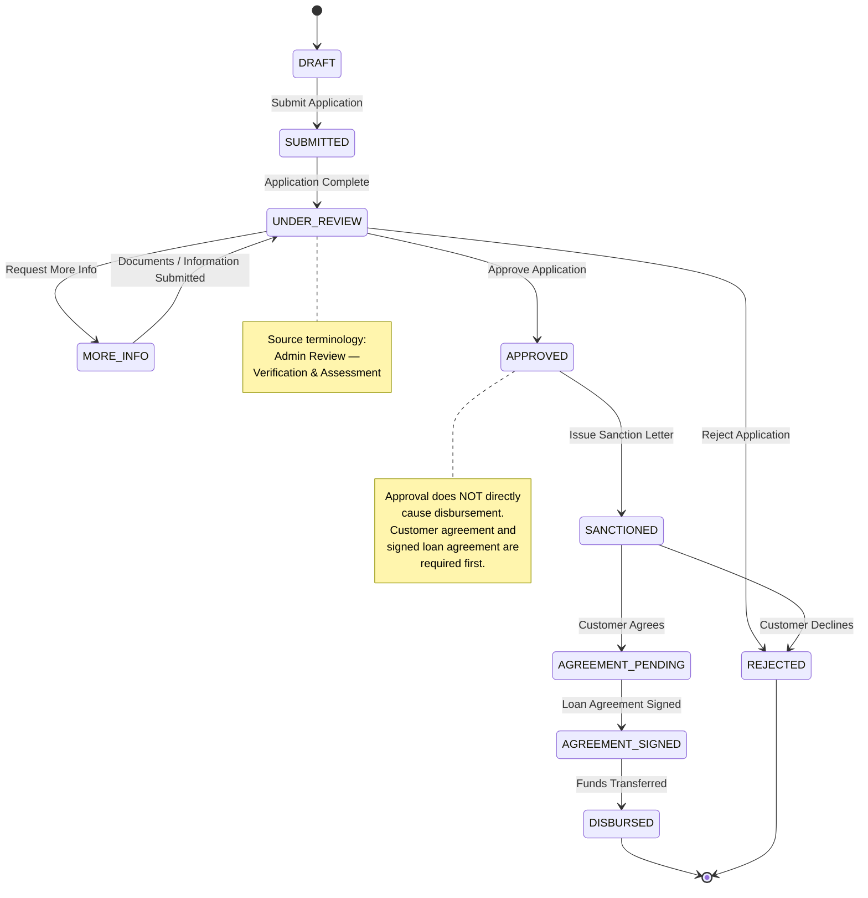
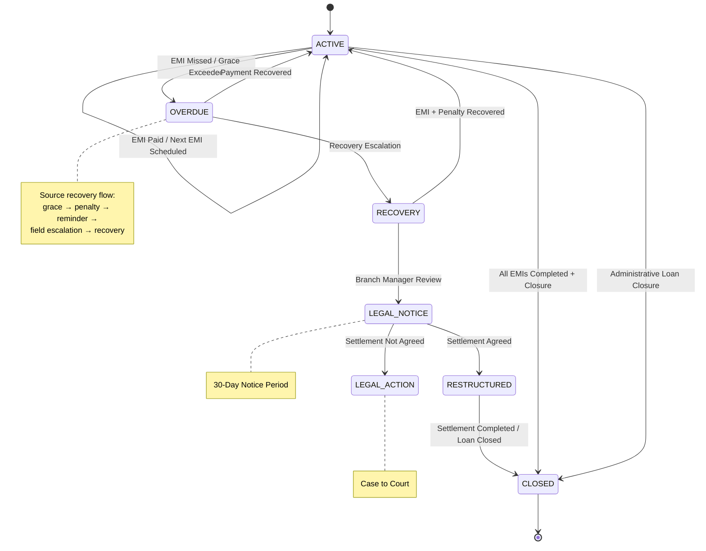
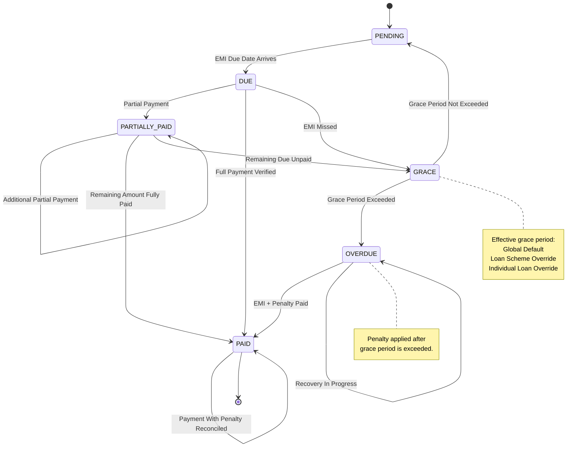
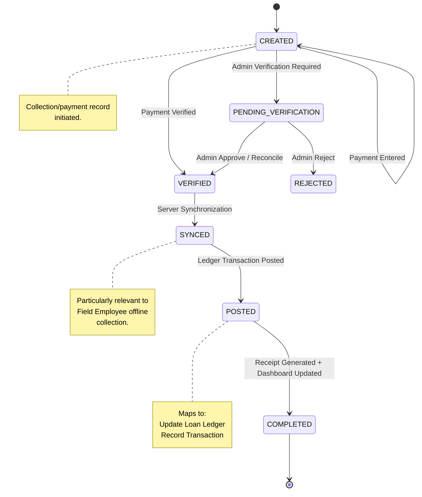
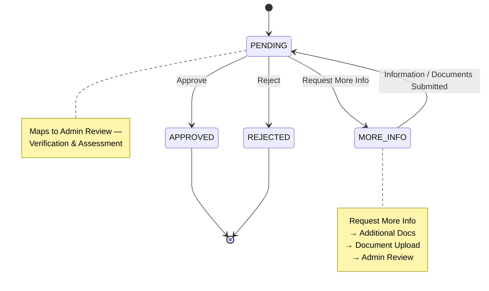
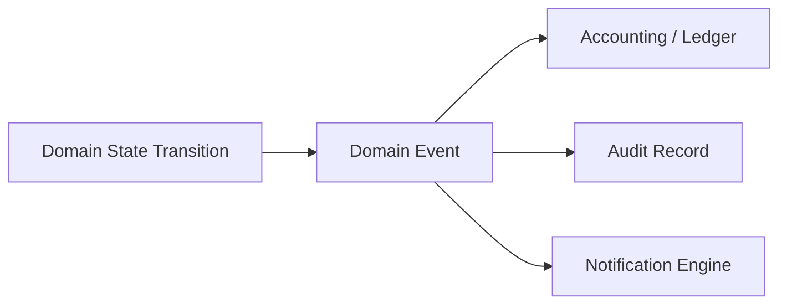

# LMS State Machines — Loan Application, Loan, EMI, Collection/Receipt, Approval Request

## 1. Source Basis and State-Machine Boundary

These state machines are derived primarily from:

- **LMS — 06 Loan Lifecycle** — Admin Review, More Info, Approval/Rejection, Sanction, Customer Agreement, Disbursement, EMI cycle and Loan Closure.
- **LMS — 07 EMI Collection Flow** — payment verification, payment methods, receipt generation, ledger update, dashboard synchronization and next EMI scheduling.
- **LMS — 08 Overdue Recovery Flow** — missed EMI, grace period, penalty, reminder, field escalation, Branch Manager Review, legal notice, settlement and legal action.
- **LMS System Overview** — payment verification states, EMI pending/grace/penalty flow, ledger behavior and notification triggers.
- **LMS — 10 Notification Flow** — event-driven notifications, recipients, channels and retry behavior.

### Important source-faithfulness constraints

The requested state names contain several states that are **not explicitly defined by the diagrams**:

| Requested state                 | Source support                                      | Treatment                                                       |
| ------------------------------- | --------------------------------------------------- | --------------------------------------------------------------- |
| Loan Application `draft`        | Not explicitly named                                | Used as an implementation-level entry state; needs confirmation |
| Loan Application `under_review` | Yes — `Admin Review`                                | Direct mapping                                                  |
| Loan Application `approved`     | Yes                                                 | Direct mapping                                                  |
| Loan Application `disbursed`    | Yes — `Loan Disbursement`                           | Direct mapping                                                  |
| Loan `active`                   | Collection cycle / EMI tracking implies active loan | Reasonable lifecycle mapping                                    |
| Loan `foreclosed`               | Not shown                                           | **Not defined**                                                 |
| Loan `written-off`              | Not shown                                           | **Not defined**                                                 |
| Loan `NPA`                      | Not shown as a lifecycle state                      | **Not defined**                                                 |
| EMI `partially_paid`            | Partial payment is supported                        | State mapping is an implementation interpretation               |
| EMI `overdue`                   | Overdue/recovery flow exists                        | Supported conceptually                                          |
| EMI `waived`                    | Penalty waiver exists, EMI waiver does not          | **Do not model as EMI state yet**                               |
| Collection `created`            | Payment collection begins / Receive Payment         | Implementation mapping                                          |
| Collection `synced`             | Explicit server synchronization exists              | Direct mapping                                                  |
| Collection `posted`             | `Update Loan Ledger` / `Record Transaction`         | Direct mapping                                                  |
| Collection `reversed`           | Not shown                                           | **Not defined**                                                 |
| Approval `escalated`            | Overdue cases escalate, loan approval does not      | **Not defined for approval requests**                           |

The source explicitly states that loan approval is followed by **Customer Agrees?** and then a signed **Loan Agreement** before disbursement. Therefore, `approved → disbursed` is **not a valid direct transition** for this LMS.

---

# 2. Loan Application State Machine

## 2.1 State Model

The source flow is:

`Loan Submission → EMI Calculation → EMI Schedule → Admin Review → Approval Decision → Sanction → Customer Agreement → Loan Agreement → Disbursement`

The approval decision has three outcomes:

- More Info → Document Upload → Admin Review
- Rejected → Application Rejected
- Approved → Loan Sanction Letter

The approved path then requires customer agreement before disbursement.

### Mermaid



## 2.2 Transition Specification

| Transition                             | Trigger event                   | Guard conditions                                                        | Allowed actor                                                                     | Side effects                                                                     |
| -------------------------------------- | ------------------------------- | ----------------------------------------------------------------------- | --------------------------------------------------------------------------------- | -------------------------------------------------------------------------------- |
| `draft → submitted`                    | Submit application              | Required application data complete                                      | Application creator / authorized loan operator; exact role not explicitly defined | Application submitted; audit event                                               |
| `submitted → under_review`             | Application enters review       | Application complete; EMI schedule available                            | System / authorized admin workflow                                                | Credit/admin review begins                                                       |
| `under_review → more_info`             | Request More Info               | Additional information/documents required                               | Authorized reviewer/admin                                                         | Request additional docs/info; audit event                                        |
| `more_info → under_review`             | Documents/information submitted | Requested information supplied                                          | Authorized application operator                                                   | Uploaded documents linked; review resumes                                        |
| `under_review → approved`              | Approve application             | Credit assessment and verification satisfactory                         | **Authorized approval authority; exact role is unresolved by source**             | Loan Approved event; SMS + App Push to Customer and Branch Admin                 |
| `under_review → rejected`              | Reject application              | Rejection reason recorded                                               | **Authorized approval authority; exact role unresolved**                          | Status `REJECTED`; rejection reason; SMS + App Push to Customer and Branch Admin |
| `approved → sanctioned`                | Issue sanction letter           | Application approved                                                    | Authorized loan operator/system                                                   | Sanction letter issued; audit event                                              |
| `sanctioned → rejected`                | Customer declines sanction      | Customer explicitly does not agree                                      | Customer                                                                          | Loan rejected; notify customer; archive                                          |
| `sanctioned → agreement_pending`       | Customer agrees                 | Customer accepts sanction                                               | Customer                                                                          | Agreement workflow initiated                                                     |
| `agreement_pending → agreement_signed` | Agreement signed                | Required agreement completed                                            | Customer                                                                          | Signed agreement recorded; audit event                                           |
| `agreement_signed → disbursed`         | Fund transfer completed         | Signed agreement exists; disbursement scheduled; fund transfer succeeds | Authorized disbursement operator/system                                           | Disbursement recorded in ledger; loan disbursement completed                     |
| `disbursed → end`                      | Disbursement completed          | Funds transferred                                                       | System                                                                            | Repayment schedule generated/shared; collection cycle begins                     |

### Ledger side effects

The source explicitly states that **Disbursement Complete** records the transaction in the ledger.

The exact accounting journal accounts/debit-credit structure is **not defined by the supplied lifecycle diagrams**, so this document does not invent account mappings.

### Notification side effects

The Notification Flow defines:

- `LOAN_APPROVED` → SMS + App Push → Customer + Branch Admin
- `LOAN_REJECTED` → SMS + App Push → Customer + Branch Admin

---

# 3. Loan State Machine

## 3.1 Source-Supported Loan Lifecycle

The lifecycle source clearly supports:

- loan disbursement
- active repayment/collection cycle
- good standing
- overdue/recovery
- closure
- restructuring/closed outcome after settlement
- legal escalation

However, **Foreclosed, Written-Off and NPA are not defined as loan lifecycle states in the supplied diagrams**.

The Reports flow does expose `Active / Closed / Overdue` as Loan Report categories, but that does not establish `NPA`, `FORECLOSED`, or `WRITTEN_OFF` as lifecycle states.

### Mermaid — source-faithful model



The source says that successful settlement results in **Loan Restructured / Closed**, while failure leads to **Legal Action Filed / Case to Court**.

## 3.2 Requested but Undefined Loan States

These should **not be implemented as business lifecycle transitions until the business rules are supplied**:

```text
ACTIVE → FORECLOSED
ACTIVE → WRITTEN_OFF
ACTIVE → NPA

OVERDUE → NPA
NPA → WRITTEN_OFF
NPA → FORECLOSED
```

There is no source-defined:

- NPA recognition rule
- days-past-due threshold for NPA
- foreclosure process
- foreclosure settlement calculation
- write-off authority
- write-off accounting treatment
- reversal of write-off
- NPA → recovery behavior
- foreclosure → closure behavior

Adding these now would be inventing business rules.

## 3.3 Transition Specification

| Transition                           | Trigger                       | Guard                                                             | Allowed actor                                         | Side effects                                                                   |
| ------------------------------------ | ----------------------------- | ----------------------------------------------------------------- | ----------------------------------------------------- | ------------------------------------------------------------------------------ |
| `active → active`                    | EMI successfully collected    | Payment verified; next EMI exists                                 | Authorized collector/system                           | Ledger transaction; receipt; dashboard/report update; customer SMS             |
| `active → overdue`                   | EMI missed and grace exceeded | Effective grace period expired                                    | System                                                | Penalty assessment/application; penalty notification; overdue recovery process |
| `overdue → active`                   | Payment recovered             | EMI + applicable penalty received and verified                    | Authorized collector/admin                            | Ledger updated; receipt generated; penalty cleared; next EMI scheduled         |
| `overdue → recovery`                 | Recovery escalation required  | Customer did not respond to reminder / field escalation initiated | Authorized recovery workflow                          | Field agent assignment and visit scheduling                                    |
| `recovery → active`                  | Field payment received        | EMI + penalty collected and verified                              | Field Collection Agent / authorized collector         | Receipt; ledger update; penalty cleared; next EMI                              |
| `recovery → legal_notice`            | Escalate Case                 | Field visit unsuccessful; Branch Manager Review completed         | Branch Manager / authorized recovery authority        | Legal notice issued; 30-day notice period                                      |
| `legal_notice → restructured/closed` | Settlement agreed             | Settlement authorized                                             | Permission-controlled authorized settlement authority | Settlement transaction; loan restructured/closed                               |
| `legal_notice → legal_action`        | Settlement not agreed         | 30-day notice process completed                                   | Authorized legal/recovery authority                   | Legal action filed; case proceeds to court                                     |
| `active → closed`                    | Loan completion               | All EMIs completed and closure process satisfied                  | Authorized closure workflow/system                    | NOC generated; loan marked closed; customer notified                           |
| `closed → new loan request`          | Renewal requested             | Renewal eligibility rules satisfied                               | Customer / authorized operator                        | New loan application lifecycle starts                                          |

The exact settlement approval authority is explicitly an open question in the overdue source; the broader project baseline says settlement approval is permission-based and may be Branch Admin or Super Admin when authorized.

---

# 4. EMI State Machine

## 4.1 Source Mapping

The diagrams contain:

- EMI Pending
- EMI Due Date Arrives
- EMI Paid
- EMI Collected
- On Time?
- Grace Period
- Penalty Applied
- Paid with Penalty?
- Next EMI Scheduled

Partial payment is explicitly supported by the Field Employee collection flow, but the diagram does not explicitly label an EMI lifecycle state called `PARTIALLY_PAID`.

Therefore `PARTIALLY_PAID` is a reasonable implementation state, but should be treated as a **derived state mapping**, not a literal source state.

### Mermaid



The source specifically defines an effective grace-period hierarchy of Global Default, Loan Scheme Override and Individual Loan Override.

## 4.2 Transition Specification

| Transition                        | Trigger                    | Guard                                                                       | Allowed actor                    | Side effects                                                                     |
| --------------------------------- | -------------------------- | --------------------------------------------------------------------------- | -------------------------------- | -------------------------------------------------------------------------------- |
| `pending → due`                   | EMI due date arrives       | Current date = EMI due date                                                 | System scheduler                 | EMI Due Today notification: SMS + Push + Auto-Call to Customer                   |
| `due → partially_paid`            | Partial payment received   | `0 < payment < outstanding EMI amount`; payment accepted by collection flow | Authorized collector             | Collection created; payment verification; receipt/ledger processing              |
| `partially_paid → partially_paid` | Additional partial payment | Remaining EMI balance > 0                                                   | Authorized collector             | New collection transaction; ledger update after verification                     |
| `partially_paid → paid`           | Remaining amount paid      | EMI outstanding reaches zero                                                | Authorized collector/system      | Receipt; ledger update; collection complete                                      |
| `due → paid`                      | Full payment received      | Payment amount verified and covers due amount                               | Authorized collector             | Receipt; ledger update; dashboard/branch report sync; SMS                        |
| `due → grace`                     | EMI missed                 | No qualifying payment by due date                                           | System                           | EMI Missed notification: SMS + Push + Email to Customer + Field Agent            |
| `grace → pending`                 | Grace period not exceeded  | Current date still inside configured grace window                           | System                           | No penalty; continue EMI cycle                                                   |
| `grace → overdue`                 | Grace period exceeded      | Effective grace period expired                                              | System                           | Penalty applied; penalty notification; overdue recovery starts                   |
| `overdue → paid`                  | Recovery payment received  | EMI + applicable penalty paid and verified                                  | Authorized collector/field agent | Receipt; penalty cleared; ledger updated; next EMI scheduled                     |
| `overdue → overdue`               | No recovery payment        | Recovery process continues                                                  | System/recovery workflow         | Reminder, field assignment, Branch Manager Review/legal escalation as applicable |

### EMI waiver

The source supports **penalty waiver**, not EMI waiver.

The penalty flow explicitly allows:

```text
Admin Penalty Resolution
    ├── Keep
    ├── Adjust → Adjustment Transaction
    ├── Waive  → Waiver Transaction
    └── Cancel → Cancellation Transaction
```

Therefore:

```text
EMI → WAIVED
```

should **not be implemented** until an explicit EMI-waiver business rule is provided.

---

# 5. Collection / Receipt State Machine

This lifecycle needs a distinction between the **collection/payment transaction** and the **receipt**.

The source explicitly has:

`Receive Payment → Payment Verification → Generate Receipt → Update Loan Ledger → Sync Dashboard → SMS Confirmation → Collection Complete`

The Field Employee flow additionally has:

`Upload Receipt → Network Available? → Sync Server / Queue Locally`

## 5.1 Mermaid



## 5.2 Important correction to the requested sequence

The requested:

```text
created → synced → posted
```

is **not universally applicable**.

For online collection, the source flow is effectively:

```text
Receive Payment
→ Payment Verification
→ Generate Receipt
→ Update Loan Ledger
→ Sync Dashboard
```

For offline Field Employee collection:

```text
Collect Payment
→ Store Locally
→ Queue
→ Network Restored
→ Sync to Server
```

Therefore `SYNCED` is primarily an **offline synchronization state**, not necessarily a mandatory state for every collection.

## 5.3 Transition Specification

| Transition                        | Trigger                                | Guard                                       | Allowed actor                 | Side effects                                                     |
| --------------------------------- | -------------------------------------- | ------------------------------------------- | ----------------------------- | ---------------------------------------------------------------- |
| `created → pending_verification`  | Payment cannot be immediately verified | Verification requires administrative review | Collector/system              | Pending verification record; audit event                         |
| `created → verified`              | Payment verification succeeds          | Amount correct; payment details valid       | Authorized collector/system   | Collection accepted                                              |
| `pending_verification → verified` | Admin approves/reconciles              | Authorized admin confirms payment           | Authorized Admin              | Verification decision audited                                    |
| `pending_verification → rejected` | Admin rejects                          | Payment cannot be reconciled                | Authorized Admin              | Collection rejected; audit event                                 |
| `created → synced`                | Offline collection synchronized        | Network restored; queued record available   | System                        | Server record created/updated; idempotency required              |
| `verified → synced`               | Server synchronization                 | Collection not already synchronized         | System                        | Server synchronization                                           |
| `synced → posted`                 | Ledger posting                         | Payment successfully committed              | Accounting/collection service | Loan ledger transaction recorded                                 |
| `posted → completed`              | Collection finalized                   | Receipt/dashboard update successful         | System                        | Receipt available; customer SMS confirmation; next EMI scheduled |

### Ledger

The source requires:

```text
Update Loan Ledger
Record Transaction
```

after successful payment verification.

The exact debit/credit account mappings are **not specified by these diagrams**, so they should be defined separately in the Accounting/Ledger specification.

### Receipt

Receipt generation is associated with:

- PDF/Print
- SMS confirmation to customer
- Receipt event notification

The Notification Flow defines `Receipt Generated → SMS + PDF Receipt → Customer`.

## 5.4 Reversal

The requested:

```text
posted → reversed
```

is **not source-defined**.

There is no supplied flow for:

- payment reversal
- receipt cancellation
- ledger reversal journal
- authorization
- reversal reason
- customer notification
- reversal after day closing

Therefore **do not implement `REVERSED` yet**.

A reversal must never be implemented as an overwrite of the posted transaction because the project baseline explicitly requires financial history to remain auditable and not be silently overwritten.

---

# 6. Approval Request State Machine

## 6.1 Source Limitation

The supplied Loan Lifecycle defines an **Admin Review** and `Loan Approved?` decision, but it does **not define a separate Approval Request entity/state machine**.

The source supports:

```text
Admin Review
    ├── More Info
    ├── Approved
    └── Rejected
```

It does **not** define an approval escalation path for loan approval.

The overdue flow does contain escalation, but that is **recovery escalation**, not approval escalation.

## 6.2 Source-supported Approval State Machine



## 6.3 Transition Specification

| Transition            | Trigger                          | Guard                                     | Allowed actor                                            | Side effects                                                            |
| --------------------- | -------------------------------- | ----------------------------------------- | -------------------------------------------------------- | ----------------------------------------------------------------------- |
| `pending → approved`  | Approve loan/application         | Verification and assessment satisfactory  | Authorized approval authority; **exact role unresolved** | `LOAN_APPROVED` event; SMS + App Push to Customer + Branch Admin; audit |
| `pending → rejected`  | Reject loan/application          | Rejection reason recorded                 | Authorized approval authority; **exact role unresolved** | `LOAN_REJECTED` event; SMS + App Push to Customer + Branch Admin; audit |
| `pending → more_info` | Request More Info                | Additional documents/information required | Authorized reviewer                                      | Request documents/information; audit                                    |
| `more_info → pending` | Additional information submitted | Required information received             | Authorized application operator                          | Documents linked; review resumes                                        |

### Who can approve?

This is intentionally **not resolved**.

The Branch Admin diagram contains `Loan Approved?`, but its own open questions explicitly ask:

> Loan Approval Authority — The diagram contains Loan Approved? but does not explicitly identify which user/role makes the decision.

Therefore the implementation should not hard-code:

```text
Branch Admin = Loan Approver
```

unless that business rule is explicitly confirmed.

---

# 7. Notification Side-Effect Matrix

State transitions should emit **domain events**, while the Notification Engine handles delivery.

| Domain event        | Channels               | Recipients              |
| ------------------- | ---------------------- | ----------------------- |
| `LOAN_APPROVED`     | SMS + Push             | Customer + Branch Admin |
| `LOAN_REJECTED`     | SMS + Push             | Customer + Branch Admin |
| `EMI_DUE_TOMORROW`  | SMS + Push             | Customer                |
| `EMI_DUE_TODAY`     | SMS + Push + Auto-Call | Customer                |
| `EMI_MISSED`        | SMS + Push + Email     | Customer + Field Agent  |
| `PENALTY_ADDED`     | SMS + Push             | Customer + Branch Admin |
| `RECEIPT_GENERATED` | SMS + PDF Receipt      | Customer                |
| `LOAN_CLOSED`       | SMS + App + Email      | Customer + Branch Admin |

Notification delivery is independently logged, retried up to **3 attempts**, and failed delivery eventually results in an admin alert.

A notification failure must **not roll back a successful payment or ledger transaction**.

---

# 8. Cross-State Ledger Rules

The state machines should not directly implement arbitrary accounting entries inside every transition.

Instead:



## Ledger-affecting source events

| Event                       | Ledger relevance                                                           |
| --------------------------- | -------------------------------------------------------------------------- |
| Loan disbursement completed | Source explicitly says record in ledger                                    |
| Verified EMI/payment        | Update Loan Ledger + Record Transaction                                    |
| Penalty cleared             | Ledger Updated                                                             |
| Settlement completed        | Financial transaction implied by settlement, but exact journal not defined |
| Loan closure final payment  | Update Loan Ledger before marking loan closed                              |

The exact double-entry account mappings are **not specified by these diagrams**, so they should be defined separately in the Accounting/Ledger specification.

---

# 9. Recommended Canonical Status Set

Based strictly on what the current diagrams support, the safest canonical statuses are:

## Loan Application

```text
DRAFT                  # implementation entry state; needs confirmation
SUBMITTED
UNDER_REVIEW
MORE_INFO_REQUIRED
APPROVED
SANCTIONED
AGREEMENT_PENDING
AGREEMENT_SIGNED
DISBURSED
REJECTED
```

## Loan

```text
ACTIVE
OVERDUE
RECOVERY
LEGAL_NOTICE
RESTRUCTURED
CLOSED
```

`FORECLOSED`, `WRITTEN_OFF`, and `NPA` should remain undefined until business rules are supplied.

## EMI

```text
PENDING
DUE
PARTIALLY_PAID        # derived from supported partial-payment flow
GRACE
OVERDUE
PAID
```

Do not add `WAIVED` yet.

## Collection / Payment

```text
CREATED
PENDING_VERIFICATION
VERIFIED
SYNCED
POSTED
COMPLETED
REJECTED
```

Do not add `REVERSED` yet.

## Approval Request

```text
PENDING
MORE_INFO_REQUIRED
APPROVED
REJECTED
```

Do not add `ESCALATED` yet.

---

# 10. Critical Implementation Rule

Do **not** implement the requested simplified transitions literally where they conflict with the source.

For example, this is incorrect:

```text
APPROVED → DISBURSED
```

The source requires:

```text
APPROVED
    ↓
LOAN SANCTION LETTER
    ↓
CUSTOMER AGREES?
    ├── No  → REJECTED
    └── Yes
          ↓
    LOAN AGREEMENT SIGNED
          ↓
    DISBURSEMENT SCHEDULED
          ↓
    FUND TRANSFER
          ↓
    DISBURSEMENT COMPLETE
          ↓
    DISBURSED
```

Likewise, this should **not** currently be implemented:

```text
ACTIVE → NPA
ACTIVE → FORECLOSED
ACTIVE → WRITTEN_OFF
```

because the supplied diagrams do not define the guards, authority, accounting treatment, or operational workflows for those transitions.

The same applies to:

```text
EMI → WAIVED
COLLECTION → REVERSED
APPROVAL → ESCALATED
```

Those are requirements gaps, not safe assumptions.
